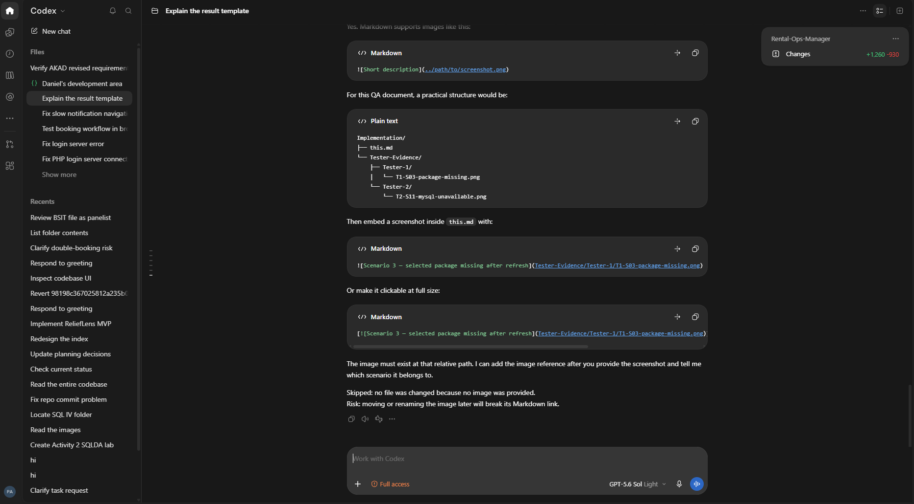

# Tester 1 QA Report — Creation, Catalog, Pricing, and Editing

Use the [Tester 1 instructions](Instructions.md) for your assigned scenarios and the [common instructions](../README.md) for shared rules. Edit only this report and files under `Evidence/`.

## Environment

- **Tester:**
- **Laptop / environment:**
- **Browser and version:**
- **PHP / MySQL version:**
- **Database baseline file or Git commit:**
- **Starting counts — bookings / customers / payments / pending sync:**

## Results

Enter exactly `PASS`, `FAIL`, `BLOCKED`, or `NOT RUN`. Use `N/A` when no booking was created and `None` when no screenshot or note is needed.

| Scenario | Outcome | Booking reference(s) | Screenshot filename | Notes / Bug ID |
| ---: | --- | --- | --- | --- |
| 1 |  |  |  |  |
| 2 |  |  |  |  |
| 3 |  |  |  |  |
| 4 |  |  |  |  |
| 5 |  |  |  |  |
| 6 |  |  |  |  |
| 7 |  |  |  |  |
| 8 |  |  |  |  |
| 9 |  |  |  |  |
| 10 |  |  |  |  |
| 41 |  |  |  |  |
| 42 |  |  |  |  |
| 43 |  |  |  |  |
| 44 |  |  |  |  |

## Screenshot evidence

Save images in `Evidence/` using `T1-S<scenario>-<short-description>.png`. Add one subsection per screenshot.

### Formatting example — not test evidence

This screenshot only demonstrates how an Obsidian image appears in the Markdown source. Remove this example before recording live test evidence.

<!-- Example for another screenshot:
### Scenario 3

-->

## Bug list

Use IDs `T1-BUG-01`, `T1-BUG-02`, and so on.

| Bug ID | Scenario | Severity | Short issue | Screenshot | Retest? |
| --- | ---: | --- | --- | --- | --- |
|  |  |  |  |  |  |

## Detailed bug records

Copy this subsection once for every bug.

### Bug ID — short title

- **Scenario / booking reference:**
- **Process section:**
- **Severity:** Critical / High / Medium / Low
- **Exact steps to reproduce:**
- **Expected result:**
- **Actual result:**
- **Exact error message:**
- **Does it still happen after refresh/reopen?**
- **Which screens disagree?**
- **Screenshot filename:**
- **Recommended fix or clarification:**

## Summary and handoff

- **PASS:**
- **FAIL:**
- **BLOCKED:**
- **NOT RUN:**
- **Critical / High / Medium / Low bugs:**
- **Scenarios needing retest:**
- **Workflow stages not reached:**
- **Overall assessment:**

Before handoff:

- [ ] Restore or deactivate every `TEMP QA` catalog record.
- [ ] Verify every FAIL and BLOCKED result has screenshot evidence.
- [ ] Verify image links render in this report.
- [ ] Commit and push this report and the `Evidence/` files.
- [ ] Tell the coordinator that Tester 1 is complete.
