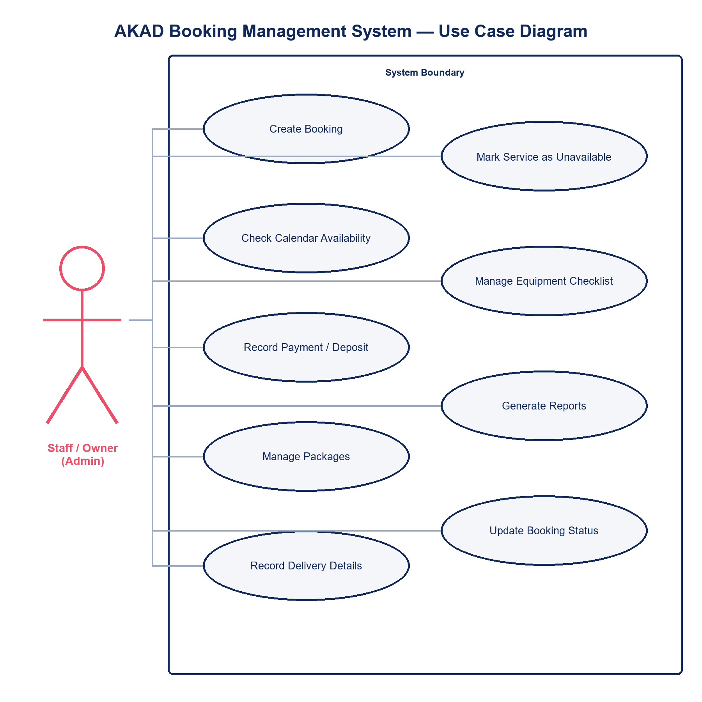

# SAD 101 · SYSTEMS ANALYSIS AND DESIGN

## Requirements Analysis & Documentation

Client: AKAD Sweet Party Rentals

Basis: Findings from the stakeholder interview conducted August 20, 2026, with the owner of AKAD Sweet Party Rentals.

Prepared by: RJDM Collective — Aplan, Manansala, Cruz, Estapia

## 1. INTERVIEW FINDINGS SUMMARY

The interview confirmed that AKAD Sweet Party Rentals operates three separate service lines: JBL Karaoke Rental, Sweet Corner Setup, and Balloon Decorations. The business started in July 2026 with the karaoke service. It is run by 2 owner-partners and 1 staff member, with deliveries handled via Lalamove, self-pickup, or the owners themselves.

Bookings are currently coordinated entirely through a Facebook Messenger group chat for transaction notes, and a manually-edited Canva graphic that is redesigned for every single booking change — a slow, error-prone process that is the clearest opportunity for a system to help. Despite this, the owner reports no double-bookings so far, largely because only one karaoke set is offered at a time.

Payments are collected through GCash or MariBank. The interview notes indicate a possible minimum down payment of ₱1,000, but the amount and the services or packages to which it applies require client validation. Optional refundable deposits may be recorded when required by the selected service or package to cover cleaning, missing-item, or damage charges. The owner currently uses an informal equipment checklist. The interview notes indicate that the system is primarily intended for internal administrative use, but the exclusion of a public customer-facing booking portal requires explicit client validation. The proposed system also includes a consolidated calendar view and automated reporting.

## 2. CATEGORIZED & PRIORITIZED REQUIREMENTS (MOSCOW)

Requirements are classified as Functional (specific system behavior) or Non-Functional (quality/constraint), then prioritized using MoSCoW based on how directly they address the pain points raised in the interview (manual Canva calendar editing, deposit/cleaning disputes, and the desire to avoid a public booking portal).

| ID | Requirement | Type | Priority | Source (Q#) |
| --- | --- | --- | --- | --- |
| FR-01 | Record a new booking (customer name, contact, event date, location, service line) for karaoke, sweet corner, or balloon decoration. | Functional | Must | Q1, Q6 |
| FR-02 | Display a consolidated calendar showing all bookings across the three service lines in one view. While online, the calendar shall automatically check for updated booking information at least every 30 seconds without requiring a full-page reload. | Functional | Must | Q7, Q18 |
| FR-03 | Prevent double-booking of the single karaoke set for an already-booked date/time slot. | Functional | Must | Q2, Q8, Q13 |
| FR-04 | Record down payment / reservation fee amount and status per booking. | Functional | Must | Q6, Q10 |
| FR-05 | The system shall allow authorized owners and staff to create, update, select, activate, and deactivate packages associated with any service. Inactive packages shall not be selectable for new bookings but shall remain visible in historical booking records. | Functional | Should | Q9; proposed scalable package-management design, subject to client validation |
| FR-06 | Allow authorized owners and staff to record an optional refundable equipment or cleaning deposit when required by the selected service or package, including itemized deductions for uncleaned, missing, or damaged items. | Functional | Should | Q11, Q14 |
| FR-07 | Generate automated reports (most-booked service, monthly income, upcoming bookings). | Functional | Should | Q19 |
| FR-08 | Record delivery method (self-pickup, Lalamove, owner-delivered) and whether the fee is shouldered by the renter or included. | Functional | Should | Q11 |
| FR-09 | Allow authorized owners and staff to assign an optional equipment checklist when required by the selected service or package and record each item’s condition upon release and return. | Functional | Could | Q15 |
| FR-10 | Let staff mark a service/date as unavailable internally (no public customer-facing booking portal). | Functional | Could | Q17; inferred from the current practice of posting unavailable rentals, pending client validation |
| NFR-01 | Support offline booking, deposit, and equipment-checklist entry with automatic sync to the central database once internet connectivity returns. | Non-Functional | Should | Proposed reliability enhancement; pending client validation |
| NFR-02 | System accessible from both desktop/laptop and smartphone devices. | Non-Functional | Should | Q21 |
| NFR-03 | System usable by 2 owner-partners and 1 staff member without extensive technical training. | Non-Functional | Could | Q4 |
| NFR-04 | Under the expected number of concurrent staff users, the system should display or update a booking record within three seconds under normal network conditions. | Non-Functional | Could | Proposed performance target; expected user load remains subject to client validation |
| WONT-01 | Public customer-facing self-service online booking portal. | Functional | Won't | Q17; interpreted scope decision, pending explicit client validation |

## 3. FORMAL REQUIREMENT STATEMENTS

The following core requirements are written in full "the system shall..." format with measurable acceptance criteria, following the REQ documentation standard covered in class.

| FR-02 — Type: Functional    Priority: Must Statement: The system shall display a consolidated calendar containing all Karaoke, Sweet Corner, and Balloon Decoration bookings. While online, the calendar shall automatically check for updated booking information at least every 30 seconds without requiring a full-page reload. Source: Interview with AKAD Owner, 08/20/2026 — Q7, Q18 Acceptance Criteria: All test bookings shall display the correct date, service type, and status. A booking created or updated on one connected device shall appear on another connected device within 30 seconds without requiring a full-page reload. |
| --- |
|  |

| FR-03 — Type: Functional    Priority: Must Statement: The system shall prevent staff from confirming a new karaoke booking on a date and time slot that is already reserved for the single available karaoke set. Source: Interview with AKAD Owner, 08/20/2026 — Q2, Q8, Q13 Acceptance Criteria: The system blocks or flags 100% of attempted karaoke bookings that conflict with an existing confirmed karaoke booking on the same date/time. |
| --- |

| FR-06 — Type: Functional    Priority: Should Statement: The system shall allow authorized owners and staff to record an optional refundable equipment or cleaning deposit when required by the selected service or package and apply itemized deductions for uncleaned, missing, or damaged items before releasing the refund. Source: Interview with AKAD Owner, 08/20/2026 — Q11, Q14 Acceptance Criteria: For 100% of applicable test bookings, staff can record a deposit amount, apply a deduction with a required reason, and obtain the correct final refundable amount. Bookings that do not require a deposit shall not be forced to include one. |
| --- |

| NFR-01 — Type: Non-Functional    Priority: Should Statement: The system shall allow staff to create and update bookings, deposits, and equipment checklist entries while offline, storing changes locally on the device, and shall automatically synchronize all queued changes with the central database once internet connectivity is restored, without manual re-entry. Source: Proposed reliability enhancement; pending validation by the AKAD owner Acceptance Criteria: (1) An entry made offline is saved locally and labeled "Pending Sync." (2) Once online, 100% of queued changes upload automatically within 30 seconds with no manual re-entry. (3) Connected devices shall reflect successfully synchronized changes within 30 seconds or upon the next page load, whichever occurs first. (4) Conflicting offline bookings (e.g., same karaoke date entered on two devices) are flagged for staff review during sync rather than silently overwritten. |
| --- |
|  |

## 4. REQUIREMENTS TRACEABILITY MATRIX (RTM)

Each requirement is linked to its interview source or documented design rationale to support validation and future impact analysis. Requirements based on interpretation or proposed enhancements are identified as pending client validation.

| Req. ID | Requirement Summary | Source | Test Case ID |
| --- | --- | --- | --- |
| FR-01 | Create booking with customer & event details | Interview, AKAD Owner, 08/20/2026 | TC-01 |
| FR-02 | Consolidated multi-service calendar view | Interview, AKAD Owner, Q7/Q18 | TC-02 |
| FR-03 | Prevent karaoke double-booking | Interview, AKAD Owner, Q2/Q8/Q13 | TC-03 |
| FR-04 | Record down payment / reservation fee | Interview, AKAD Owner, Q6/Q10 | TC-04 |
| FR-05 | The system shall allow authorized owners and staff to create, update, select, activate, and deactivate packages associated with any service. Inactive packages shall not be selectable for new bookings but shall remain visible in historical booking records. | Q9; proposed scalable design, subject to client validation | TC-05 |
| FR-06 | Optional refundable deposit and itemized deductions | Interview, AKAD Owner, Q11/Q14 | TC-06 |
| FR-07 | Generate automated booking/income reports | Interview, AKAD Owner, Q19 | TC-07 |
| FR-08 | Record delivery method & fee responsibility | Interview, AKAD Owner, Q11 | TC-08 |
| FR-09 | Optional equipment checklist for release and return | Interview, AKAD Owner, Q15 | TC-09 |
| FR-10 | Internal-only unavailability marking | Q17; inferred from the current practice of posting unavailable rentals, pending client validation | TC-10 |
| NFR-01 | Offline booking, deposit, and equipment-checklist entry with auto-sync | Proposed reliability enhancement; pending client validation | TC-11 |
| NFR-02 | Multi-device access (desktop + mobile) | Interview, AKAD Owner, Q21 | TC-12 |

## 5. USE CASE DIAGRAM

The diagram below models the primary interactions between the Staff/Owner and the core functions of the proposed AKAD Booking Management System. The Staff/Owner is currently shown as the only system actor because the proposed scope treats the system as an internal administrative tool. The exclusion of a public customer-facing portal remains subject to explicit client validation.

## 6. NOTES & OPEN ITEMS FOR VALIDATION

The owner did not name a specific improvement beyond "smoother transactions" (Q16) — worth probing further in a follow-up validation session once a prototype/mockup exists to react to.

Q23 (peak season) answer referenced "camping rentals" and a summer peak, which doesn't match AKAD's three stated service lines — flagged for clarification with the owner rather than assumed.

Budget and system sign-off authority were not covered in this round and should be confirmed before finalizing scope.

This summary should be sent to AKAD Sweet Party Rentals for validation before the Requirements Specification Document is finalized, following the Confirm and Follow-Up steps of the interview process.
