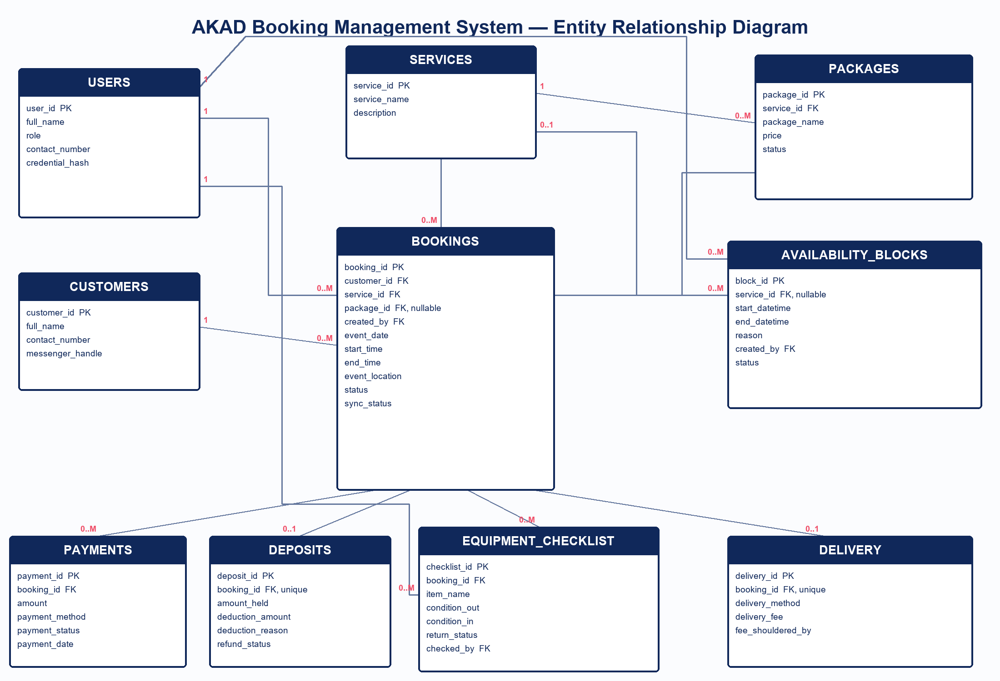
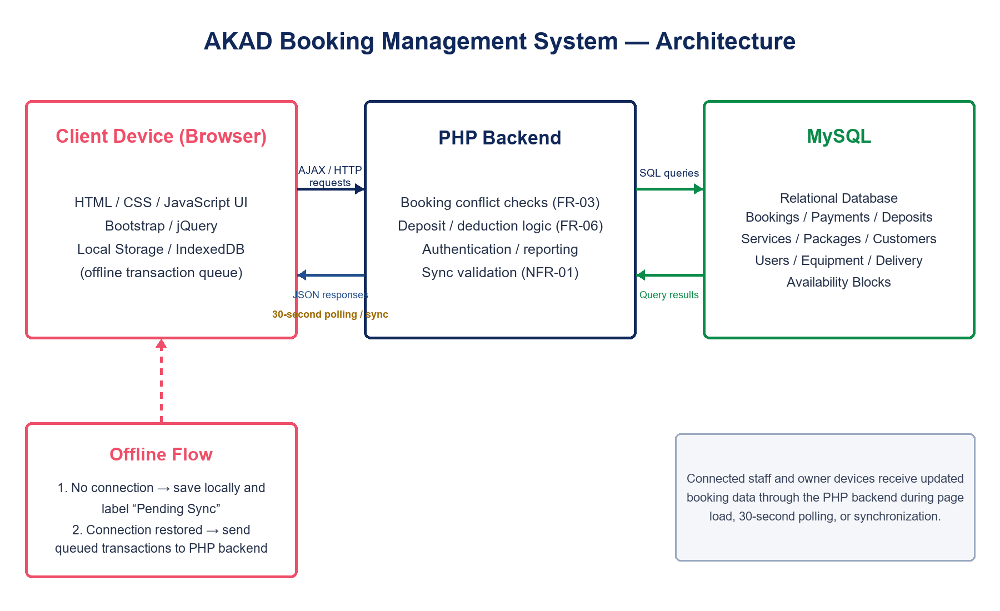

# SAD 101 · SYSTEMS ANALYSIS AND DESIGN

## System Design — Tech Stack, Database Schema & Architecture

Client: AKAD Sweet Party Rentals

Companion document to AKAD Requirements Analysis Documentation. This document translates the current documented requirements into a concrete technical design while preserving identified items for client validation.  Prepared by: RJDM Collective — Aplan, Manansala, Cruz, Estapia

## 1. PROPOSED TECHNOLOGY STACK

The stack was chosen to satisfy FR-02 for an automatically refreshed consolidated calendar and to support the proposed NFR-01 offline-entry and synchronization capability if validated by the client, while keeping the database relational.

| Layer | Technology | Role in the System |
| --- | --- | --- |
| Frontend | HTML, CSS, JavaScript, Bootstrap, jQuery | Provides the responsive user interface for staff/owners, including booking forms, calendar views, equipment checklists, dashboards, and reports. Bootstrap supports responsive layout and interface components, while jQuery simplifies DOM manipulation, AJAX requests, and interactive features. |
| Backend | PHP | Handles server-side processing and system business rules, including booking management, karaoke double-booking prevention, deposit and deduction calculations, authentication, reporting, and offline synchronization requests. |
| Database | MySQL | Stores relational system data including users, customers, services, packages, bookings, payments, deposits, equipment checklists, delivery information, and availability blocks. |
| Offline Storage | Browser localStorage / IndexedDB | If offline functionality is validated, temporarily queues booking, deposit, and equipment-checklist entries created or updated while offline until connectivity returns. Each queued transaction shall include a client-generated identifier and local creation or modification time to support duplicate detection and conflict review under NFR-01. |

Note: PHP and MySQL were selected because they provide a widely supported, relational, and practical web development environment suitable for the project requirements. AJAX requests using jQuery will allow the frontend to communicate asynchronously with the PHP backend without requiring full page reloads. Bootstrap will support responsive access across desktop, laptop, and smartphone devices. Browser-based localStorage and IndexedDB will be used to support temporary offline data storage and synchronization.

## 2. DATABASE SCHEMA — ENTITY SUMMARY

Ten entities support the current documented requirements, including the proposed internal service and date unavailability management described in FR-10. The Entity Relationship Diagram in Section 3 shows the primary database attributes and relationships, while the accompanying entity table provides additional field constraints and descriptions.

| Entity | Key Fields | Purpose |
| --- | --- | --- |
| USERS | user_id (PK), full_name, role, contact_number, credential_hash | Owners and staff who log in and manage bookings. The credential hash may represent a password or PIN, depending on the authentication approach confirmed by the client. |
| CUSTOMERS | customer_id (PK), full_name, contact_number, messenger_handle | People renting AKAD's services. |
| SERVICES | service_id (PK), service_name, description | The 3 core offerings: Karaoke, Sweet Corner, Balloon Decoration. |
| AVAILABILITY_BLOCKS | block_id (PK), service_id (FK, nullable), start_datetime, end_datetime, reason, created_by (FK), status | Records periods when one service or all services are unavailable. Authorized owners and staff may activate or deactivate a block without deleting its historical record. |
| PACKAGES | package_id (PK), service_id (FK), package_name, price, status | Packages associated with any service. Authorized owners and staff may activate or deactivate packages. Inactive packages remain available for historical booking records but cannot be selected for new bookings. |
| BOOKINGS | booking_id (PK), customer_id (FK), service_id (FK), package_id (FK, nullable), created_by (FK), event_date, start_time, end_time, event_location, status, sync_status | Central record of every rental transaction; links all other entities. |
| PAYMENTS | payment_id (PK), booking_id (FK), amount, payment_method, payment_status, payment_date | Down payments and balance payments (GCash/MariBank). |
| DEPOSITS | deposit_id (PK), booking_id (FK, unique), amount_held, deduction_amount, deduction_reason, refund_status | Optional refundable deposits assigned to bookings when required by the selected service or package, with itemized deductions for uncleaned, missing, or damaged items. |
| EQUIPMENT_CHECKLIST | checklist_id (PK), booking_id (FK), item_name, condition_out, condition_in, return_status, checked_by (FK) | Optional equipment checklist assigned to a booking when required by the selected service or package, recording each item’s condition upon release and return. |
| DELIVERY | delivery_id (PK), booking_id (FK, unique), delivery_method, delivery_fee, fee_shouldered_by | Tracks delivery method (self-pickup, Lalamove, owner-delivered) and fee responsibility. |

## 3. ENTITY RELATIONSHIP DIAGRAM (ERD)

BOOKINGS is the central entity, linking a customer, the service/package selected, the staff member who created it, and its associated payments, deposit, equipment checklist, and delivery details.

## 4. SYSTEM ARCHITECTURE

The system architecture separates the client-side web interface, the PHP backend, and the MySQL relational database. The client interface will be developed using HTML, CSS, JavaScript, Bootstrap, and jQuery. PHP will process requests, enforce business rules, and communicate with the MySQL database. Browser-based localStorage or IndexedDB will provide temporary offline storage for selected transactions.

• When online, the browser sends requests using jQuery AJAX to PHP scripts. PHP validates the required business rules before storing or updating records in the MySQL database.

• Calendar and booking information will be retrieved asynchronously from the MySQL database through PHP and AJAX. While the user is online, the client shall poll the PHP backend every 30 seconds for updated booking information. When changed data is returned, the calendar shall update without requiring a full-page reload.

• When offline, supported transactions will be temporarily stored in localStorage or IndexedDB and labeled “Pending Sync.”

• Once internet connectivity is restored, queued transactions will be sent through AJAX to the PHP backend. PHP will validate the queued data, use the client-generated identifier to prevent duplicate submissions, and check for booking or record conflicts before saving valid records to the MySQL database. If the corresponding server record has changed, the queued transaction shall be flagged for staff review instead of silently overwriting the server record.

## 5. OPEN ITEMS BEFORE DEVELOPMENT

Confirm authentication approach (username/email and password vs. simple PIN login) based on owner/staff comfort with technology. Authentication credentials and authorized user information will be managed through the PHP backend and MySQL database.

Confirm whether offline transaction recording and automatic synchronization are required. If confirmed, identify the transactions that must be available offline and validate the synchronization and conflict-review rules.
