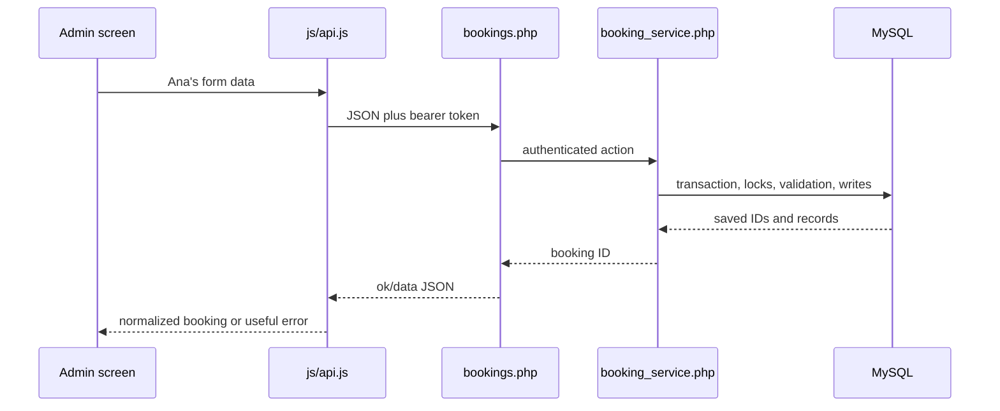

# Backend Request Lifecycle

**Guide:** [Start Here](../Start%20Here.md) · [System Overview](../System%20Overview.md) · [Glossary](../Glossary.md) · [Known Limits](../Current%20Implementation%20Gaps.md)

## Ana saves a confirmed booking

## Stages

1. `config.php` applies transport/CORS rules and opens PDO on demand.
2. `auth.php` validates and refreshes the active owner session.
3. The endpoint parses method, `do`, query IDs, and JSON.
4. A shared service validates types, relationships, states, and money.
5. Domain transactions lock relevant rows/services, write the business record, audit, notifications, and snapshots together, then commit.
6. The endpoint returns `{ "ok": true, "data": ... }`. Domain errors roll back and return validation, conflict, stale, forbidden, or not-found responses.

Offline replay enters through `sync.php`, but steps 4–5 use the same services. Each queued operation owns its transaction, so the returned batch can contain accepted, conflicting, and failed results together.
