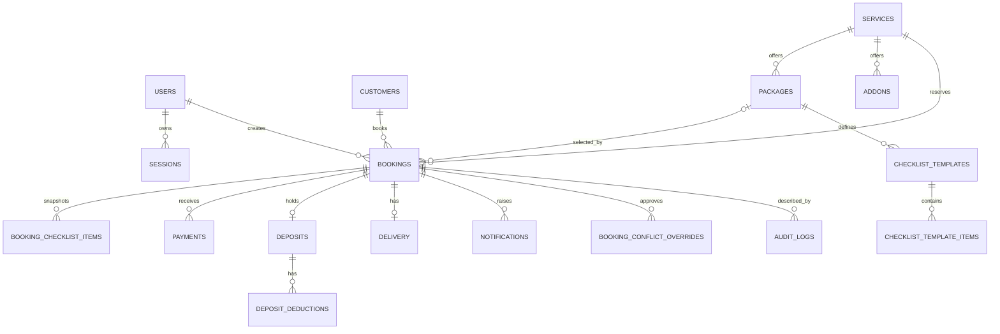

# Database Table Relationships

**Guide:** [Start Here](../Start%20Here.md) · [System Overview](../System%20Overview.md) · [Glossary](../Glossary.md) · [Known Limits](../Current%20Implementation%20Gaps.md)

## Main operational graph

## How to interpret it

The booking is the center of operational history. Catalog rows may be made inactive, while booking snapshots retain agreed package/checklist facts. Child rows such as payments and deposits are retained when a booking is cancelled because cancellation changes status instead of deleting the booking.

## Exact constraints and deletion behavior

Each [table page](Database%20Overview.md#table-groups) reproduces its current column definitions, keys, and foreign keys directly from `db/schema.sql`. Many catalog/account deletes use `RESTRICT`; booking-owned legacy children often use `CASCADE`; historical item links generally use `SET NULL` or are protected by service validation. Application services can be stricter than the SQL action—for example, referenced rental items are rejected before deletion to preserve history.

## Known model differences

- Revised operations use one service per booking even though the legacy `service_ids` JSON column remains.
- Revised checklists use `CHECKLIST_*` and `BOOKING_CHECKLIST_ITEMS`; legacy checklist tables remain.
- `DEPOSITS` and `DELIVERY` are zero-or-one per booking because `booking_id` is unique.
- `CATEGORIES` has no foreign key to `SERVICES`.
- `AVAILABILITY_BLOCKS` exists structurally but its product feature is deferred.

## Technical navigation

[Database Overview](Database%20Overview.md) · [Schema and Seed Setup](Schema%20and%20Seed%20Setup.md) · [Start Here](../Start%20Here.md)
