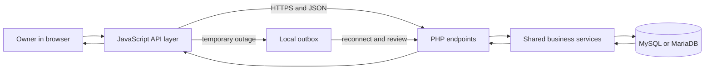

# System Overview

**Guide:** [Start Here](Start%20Here.md) · [System Overview](System%20Overview.md) · [Glossary](Glossary.md) · [Known Limits](Current%20Implementation%20Gaps.md)

## Part A — Understanding the System

This part is for everyone. Technical names are introduced only after the business story is clear.

### What is the system?

Rental-Ops-Manager is an owner-operated web application for running AKAD's rental work. The browser provides admin screens. JavaScript validates input, calls PHP endpoints, and can queue supported changes locally. PHP authenticates owners, enforces business rules, performs transactions, and returns JSON. MySQL/MariaDB stores the shared record.

### Why does the business need it?

A rental joins facts that must stay consistent: the customer, one service, an optional package, event time, pricing, payments, delivery, equipment, availability, and post-event review. The system keeps those facts connected and retains history when a booking is cancelled or a catalog item becomes inactive.

### Follow Ana’s fictional rental

An owner creates Ana as a customer, selects one active service and optional package, adds extras, and confirms the event. The server copies package name and price, calculates the blocked interval, and checks other confirmed or unreleased bookings for the same service. Payments and a refundable deposit are recorded separately. After the event, the owner reviews the copied equipment checklist and releases the service. A remaining rental balance sends the booking to **Awaiting Payment**; otherwise it becomes **Completed**.

### See the system in one picture

The owner works with the visible website. The website passes the request to the server, and the server reads or updates the shared digital records. During a temporary outage, supported changes wait locally until they can be checked by the server.

### What Happens Behind the Scenes?

The request carries a bearer token after login. Protected endpoints refresh a valid session for 24 hours and reject inactive, expired, non-owner, or revoked sessions. Write services validate IDs, text, dates, money, controlled states, and relationships before committing. Audit and notification rows are written with sensitive workflow changes.

### Remember This

- Current authenticated use is **owner-only**, even though the legacy `USERS.role` enum still contains `staff`.
- Each booking has exactly one primary service. A package is optional; add-ons belong to that service.
- Confirmed and Awaiting Completion bookings reserve the service. Released Awaiting Payment bookings do not.
- Direct API writes and offline replay use the same shared services for the implemented operations.
- The `AVAILABILITY_BLOCKS` schema and endpoint remain in the checkout, but owner-approved scope keeps internal blockouts deferred. Do not treat them as an active supported feature.
- Local automated and synthetic checks are evidence about this checkout, not proof of production hosting, physical-device usability, accounting correctness, or client acceptance.

## Part B — Technical Explanation

Beginner readers can continue to the login lesson. This section is for readers who want the project locations and implementation boundaries.

### Technical map

- Frontend: `admin/*.html`, `js/*.js`, and `css/*.css`
- Backend: 40 PHP files in `api/` plus `scripts/reconcile_bookings.php`
- Database: 29 tables in `db/schema.sql`
- Verification: `tests/` and `Implementation/Backend-Requirement-Matrix.md`

### Technical references

[Request Lifecycle](Backend/Request%20Lifecycle.md) · [Frontend Overview](Frontend/Overview.md) · [Database Overview](Database/Database%20Overview.md) · [Source Snapshot](Source%20Snapshot.md)

## Continue Your Learning

**You’ve learned:** what Rental-Ops-Manager does and how the visible website, server rules, and shared records work together.

**Next lesson:** [Login and Authentication](Workflows/Login%20and%20Authentication.md)

**Why read this next?** Before an owner can manage Ana’s booking, the system must make sure the correct person is signed in.

**Return to your learning dashboard:** [Start Here](Start%20Here.md)
