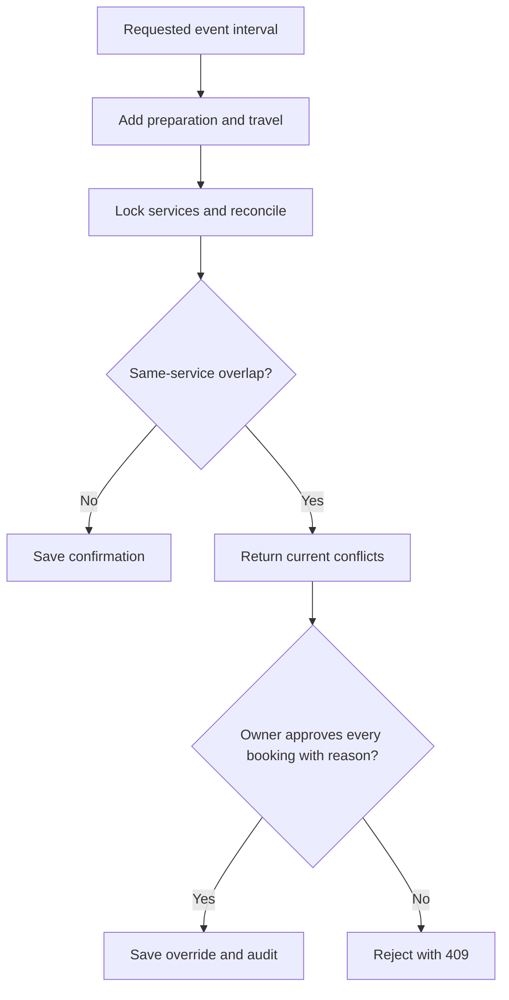

# Availability and Conflicts

**Guide:** [Start Here](../Start%20Here.md) · [System Overview](../System%20Overview.md) · [Glossary](../Glossary.md) · [Known Limits](../Current%20Implementation%20Gaps.md)

## What is this feature?

Availability asks whether the same service is already reserved during a requested blocked interval. The blocked interval includes preparation before the event and travel after it.

## Why does the system need it?

Two owners or devices may attempt overlapping bookings. The server must make the final decision and keep deliberate exceptions visible.

## Realistic example

Ana’s event runs 2:00–6:00 PM, with 30 minutes of preparation and 45 minutes of travel. The service is blocked from 1:30–6:45 PM. A second confirmed booking for the same service during that period creates a conflict.

## Step-by-step workflow

1. Copy service defaults or accept valid per-booking allowance overrides.
2. Calculate blocked start and end.
3. Lock services in a consistent order and reconcile ended bookings.
4. Compare only the same service against Confirmed and Awaiting Completion bookings.
5. If conflicts exist, return their customer, service, and event details.
6. An owner may approve every booking conflict with one required reason; the server writes an override row and audit entry.

## What happens behind the scenes?

An unreleased booking whose blocked end has passed has no effective end for conflict checking: it keeps blocking future intervals until post-event release. After a complete review, `released_by` is set and capacity is released even if money remains outstanding.

## Visual explanation

## Important rules and limitations

- Pending, Cancelled, Completed, and released Awaiting Payment bookings do not reserve capacity.
- Different services are not compared.
- Approval must name every current conflicting booking; stale approvals are rejected.
- Active availability blocks cannot be overridden by this workflow.
- Internal blockouts are deferred by owner decision even though draft schema/API artifacts remain. The frontend does not present them as an active supported feature.

## Technical details

`availability_service.php`: `blockedInterval()`, `reconcileBookings()`, `availabilityConflicts()`, `requireConflictApproval()`, `recordConflictApproval()`, `releaseBooking()`. Tables: `BOOKINGS`, `BOOKING_CONFLICT_OVERRIDES`; deferred artifact: `AVAILABILITY_BLOCKS`. Scheduler: `scripts/reconcile_bookings.php`.

## Related documentation

[Post-event Completion](Post-event%20Completion.md) · [BOOKING_CONFLICT_OVERRIDES](../Database/Tables/BOOKING_CONFLICT_OVERRIDES.md) · [Current Implementation Gaps](../Current%20Implementation%20Gaps.md)
