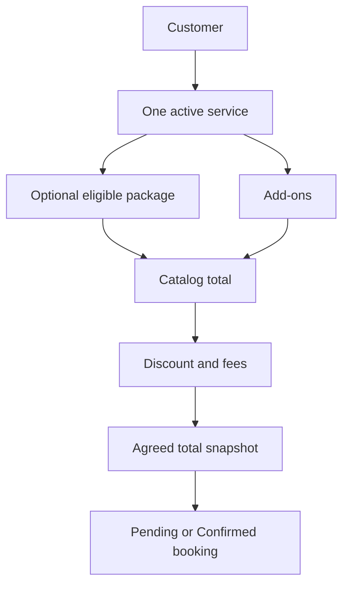

# Booking and Pricing

**Guide:** [Start Here](../Start%20Here.md) · [System Overview](../System%20Overview.md) · [Glossary](../Glossary.md) · [Known Limits](../Current%20Implementation%20Gaps.md)

## What is this feature?

A booking is the central rental record. It connects one customer to one service, an optional package, optional add-ons, an event interval, an agreed price, and later operational records.

## Why does the system need it?

The system must preserve what the owner and customer agreed even when catalog names or prices change later.

## Realistic example

Ana chooses one karaoke service, a ₱2,500 package, and a ₱300 add-on. With a ₱100 discount and ₱50 fee, the calculated total is ₱2,750. The owner may set a different negotiated `agreed_total`; that becomes the balance basis.

## Step-by-step workflow

1. Select or create Ana’s customer record.
2. Select exactly one active service and, optionally, a package belonging to it.
3. Enter start/end datetimes, location, preparation and travel allowances.
4. Select add-ons, discount, fees, and the agreed total.
5. Save as Pending or Confirmed. Confirmation checks availability.
6. The server creates a unique `AKAD-…` reference, snapshots package name/price, and copies the package checklist template.

## What happens behind the scenes?

`saveBooking()` is shared by direct and sync paths. It validates catalog relationships, promotion dates, dates, location, allowances, pricing inputs, status transitions, and conflicts in one transaction. Catalog pricing is package + add-ons − discount + fees, never below zero. `agreed_total` is the contractual booking total used for balances.

## Visual explanation

## Important rules and limitations

- A booking cannot contain several services.
- Service/package changes are allowed only while Pending.
- A package-free booking is valid; the owner supplies the agreed total.
- Cancelling requires a reason and retains linked history. A confirmed booking cannot move back to Pending.
- Pending and Confirmed are the only create states. Post-event states require the release workflow.
- Delivery fees are stored separately and are not automatically added to the booking total.

## Technical details

`api/bookings.php` exposes list/get/availability and create/update/cancel/release/complete actions. Shared logic: `booking_service.php`, `booking_pricing.php`, `availability_service.php`, `checklist_service.php`. Tables: `BOOKINGS`, `CUSTOMERS`, `SERVICES`, `PACKAGES`, `ADDONS`, `BOOKING_CHECKLIST_ITEMS`.

## Related documentation

[Availability and Conflicts](Availability%20and%20Conflicts.md) · [BOOKINGS](../Database/Tables/BOOKINGS.md) · [bookings.php](../Backend/Files/bookings.php.md)
