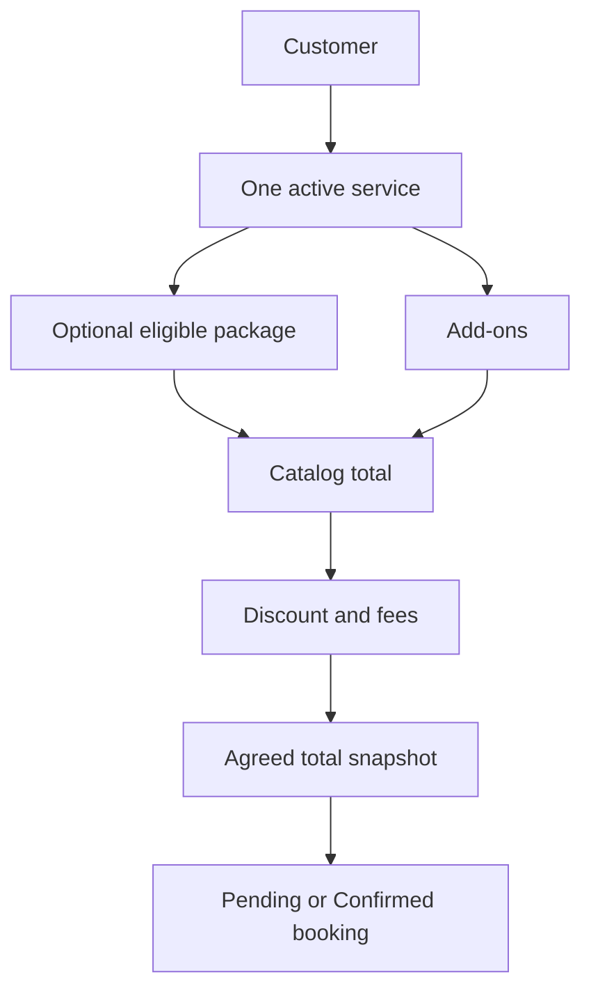

# Booking and Pricing

**Guide:** [Start Here](../Start%20Here.md) · [System Overview](../System%20Overview.md) · [Glossary](../Glossary.md) · [Known Limits](../Current%20Implementation%20Gaps.md)

## Part A — Understanding the Feature

This first part uses everyday language. You can continue to the next lesson without studying the technical section.

### What is this feature?

A booking is the central rental record. It connects one customer to one service, an optional package, optional add-ons, an event interval, an agreed price, and later operational records.

### Why does the system need it?

The system must preserve what the owner and customer agreed even when catalog names or prices change later.

### Follow Ana’s fictional rental

Ana chooses one karaoke service, a ₱2,500 package, and a ₱300 add-on. With a ₱100 discount and ₱50 fee, the calculated total is ₱2,750. The owner may set a different negotiated `agreed_total`; that becomes the balance basis.

### Step-by-step workflow

1. Select an existing customer or create Ana’s customer record.
2. Select exactly one active service and, optionally, a package belonging to it.
3. Enter start/end datetimes, location, preparation and travel allowances.
4. Select add-ons, discount, fees, and the agreed total.
5. Save the manual booking as Pending. Overlaps are shown as warnings; confirmation performs the authoritative approval check.
6. The server creates a unique `AKAD-…` reference, snapshots package name/price, and copies the package checklist template.

### What Happens Behind the Scenes?

`saveBooking()` is shared by direct and sync paths. It validates catalog relationships, promotion dates, dates, location, allowances, pricing inputs, status transitions, and conflicts in one transaction. Catalog pricing is package + add-ons − discount + fees, never below zero. `agreed_total` is the contractual booking total used for balances. Offline Pending-booking edits carry their original package, add-ons, discount, fees, and agreed total; if another device changed one first, replay stops as a visible stale conflict.

The same transaction locks an existing booking before changing its price. A new agreed total below Completed payments is rejected without changing the booking, checklist, payment, or audit records. A package already referenced by a booking may still be renamed or repriced for future catalog use, but it cannot move to another service; the booking keeps its package snapshots.

### Visual explanation

The diagram shows how the selected package, add-ons, discount, and fees lead to the agreed booking total.

### Important things to remember

- A booking cannot contain several services.
- Customer, service, package, add-ons, allowances, discounts, fees, and agreed total can be altered only while Pending.
- A booking belongs to the selected customer ID. A phone number is contact information, not a unique identity; two customers may share it without sharing bookings or totals.
- A stale offline price edit cannot silently replace a newer accepted price. The owner must review the previous, current server, and local draft values before retrying.
- Promotional packages are eligible against the booking's event date, not the date the owner enters the booking.
- A package-free booking is valid; the owner supplies the agreed total.
- A package referenced by any booking cannot move to another service; unreferenced packages may move.
- Cancelling requires a reason and retains linked history. A confirmed booking cannot move back to Pending.
- Pending and Confirmed are the only create states. Post-event states require the release workflow.
- Delivery fees are stored separately and are not automatically added to the booking total.

### Remember This

Ana’s fictional example uses a ₱2,500 package, a ₱300 add-on, a ₱100 discount, and a ₱50 fee. Her agreed rental total is ₱2,750.

## Part B — Technical Explanation

This section names the files, routes, tables, and validation rules. Beginner readers may skip it and continue to the next lesson.

### Technical details

`api/bookings.php` exposes list/get/availability and create/update/cancel/release/complete actions. Shared logic: `booking_service.php`, `booking_pricing.php`, `availability_service.php`, `checklist_service.php`. Tables: `BOOKINGS`, `CUSTOMERS`, `SERVICES`, `PACKAGES`, `ADDONS`, `BOOKING_CHECKLIST_ITEMS`.

### Technical references

[Availability and Conflicts](Availability%20and%20Conflicts.md) · [BOOKINGS](../Database/Tables/BOOKINGS.md) · [bookings.php](../Backend/Files/bookings.php.md)

## Continue Your Learning

**You’ve learned:** how Ana’s customer, service, package, extras, schedule, and agreed price become one booking.

**Previous lesson:** [Login and Authentication](Login%20and%20Authentication.md)

**Next lesson:** [Availability and Conflicts](Availability%20and%20Conflicts.md)

**Why read this next?** A confirmed booking must reserve the correct time, so the next lesson explains how the system detects schedule conflicts.

**Return to your learning dashboard:** [Start Here](../Start%20Here.md)
