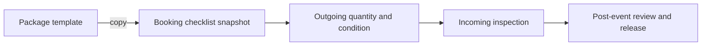

# Equipment Release and Return

**Guide:** [Start Here](../Start%20Here.md) · [System Overview](../System%20Overview.md) · [Glossary](../Glossary.md) · [Known Limits](../Current%20Implementation%20Gaps.md)

## Part A — Understanding the Feature

This first part uses everyday language. You can continue to the next lesson without studying the technical section.

### What is this feature?

Package checklist templates define expected equipment. A booking receives its own copied checklist so later template edits do not rewrite rental history.

### Why does the system need it?

Owners need to know what left, what returned, its condition, and what must be deducted from a deposit.

### Follow Ana’s fictional rental

Ana’s karaoke package template contains two microphones and one speaker. The booking snapshot records those names and quantities. At return, the owner records quantities and conditions against that snapshot.

### Step-by-step workflow

1. Maintain a versioned template and items for a package.
2. Creating or changing a Pending booking’s package copies the current template.
3. Record quantity released and outgoing condition.
4. After the event, record returned quantity, incoming condition, and inspected/damaged/missing status.
5. The final review rejects incomplete or inconsistent rows.
6. Any deductions are saved against the booking deposit before service release.

### What Happens Behind the Scenes?

`BOOKING_CHECKLIST_ITEMS` keeps snapshots plus release/return facts. `checklist_service.php` owns copies and item updates. `equipment_service.php` owns inspection and finalization. The older `EQUIPMENT_CHECKLIST` and `BOOKING_ITEMS` tables remain for transition compatibility; the revised post-event workflow uses booking checklist items.

### Visual explanation

The diagram follows equipment information from the reusable package template to Ana’s booking, outgoing release, return inspection, and final review.

### Important things to remember

- Template changes affect future copies, not existing booking snapshots.
- A package cannot change after checklist work has started.
- Returned quantity cannot exceed released quantity. A short return must be marked missing.
- Every reviewed row needs a return condition and inspected/damaged/missing state.
- Checklist rows document equipment; catalog quantity is not a real-time stock-reservation engine.

### Remember This

The booking keeps its own checklist copy. Editing the package template later does not rewrite what Ana actually received.

## Part B — Technical Explanation

This section names the files, routes, tables, and validation rules. Beginner readers may skip it and continue to the next lesson.

### Technical details

`checklistTemplates.php`, `checklist_service.php`, `bookingItems.php`, `booking_items_service.php`, `equipment.php`, `equipment_service.php`. Primary tables: `CHECKLIST_TEMPLATES`, `CHECKLIST_TEMPLATE_ITEMS`, `BOOKING_CHECKLIST_ITEMS`.

### Technical references

[Post-event Completion](Post-event%20Completion.md) · [BOOKING_CHECKLIST_ITEMS](../Database/Tables/BOOKING_CHECKLIST_ITEMS.md)

## Continue Your Learning

**You’ve learned:** how a reusable package checklist becomes a permanent checklist for Ana’s rental and records what leaves and returns.

**Previous lesson:** [Payments and Deposits](Payments%20and%20Deposits.md)

**Next lesson:** [Post-event Completion](Post-event%20Completion.md)

**Why read this next?** After the equipment comes back, the owner must review the whole rental before releasing the service and completing the booking.

**Return to your learning dashboard:** [Start Here](../Start%20Here.md)
