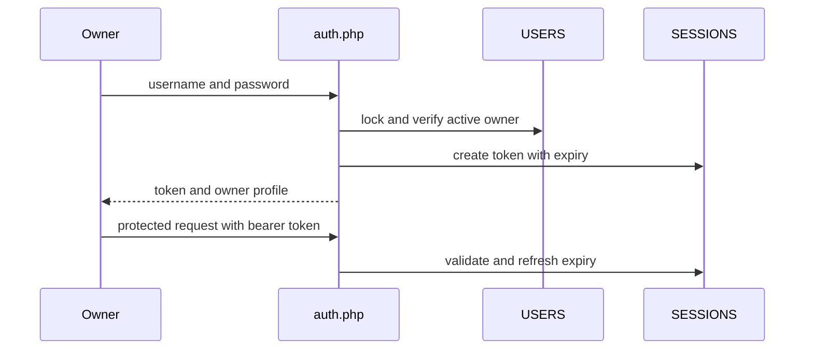

# Login and Authentication

**Guide:** [Start Here](../Start%20Here.md) · [System Overview](../System%20Overview.md) · [Glossary](../Glossary.md) · [Known Limits](../Current%20Implementation%20Gaps.md)

## What is this feature?

Authentication proves that a request belongs to an active owner. Owner management lets the primary owner create accounts, deactivate or reactivate them, and reset passwords.

## Why does the system need it?

Bookings and financial records should not be changed by an anonymous browser or an account that has been disabled.

## Realistic example

The owner signs in with a username and password before recording Ana’s booking. Five failed attempts lock that account for 15 minutes. A successful login resets the failure count.

## Step-by-step workflow

1. The browser posts credentials to `api/auth.php`.
2. PHP locks the matching user row, verifies the password hash, and creates a random session token.
3. JavaScript stores the token and sends it as `Authorization: Bearer …`.
4. Each protected request validates the owner and extends the session.
5. Logout deletes the current token. Deactivation or password reset deletes all sessions for that account.

## What happens behind the scenes?

`currentSession()` accepts only active users whose role is `owner`. Sessions last 24 hours from the most recent accepted request. Owner-administration actions run through `api/owners.php`; primary-owner rules prevent unsafe removal of the last controlling account.

## Visual explanation

## Important rules and limitations

- Current login support is owner-only. The legacy `staff` enum value does not grant a session.
- Passwords are hashed; tokens are random 64-character hexadecimal strings.
- Invalid credentials do not reveal whether the username exists.
- HTTPS and the configured production-origin allowlist must be correct at deployment.
- Seed credentials are development material and must not be deployed.

## Technical details

`POST api/auth.php`, `POST api/auth.php?do=logout`, `GET api/auth.php?do=me`; `GET/POST api/owners.php`. Tables: `USERS`, `SESSIONS`. Frontend: `admin/login.html`, `js/api.js`, `js/admin.js`.

## Related documentation

[auth.php](../Backend/Files/auth.php.md) · [owners.php](../Backend/Files/owners.php.md) · [USERS](../Database/Tables/USERS.md) · [SESSIONS](../Database/Tables/SESSIONS.md)
