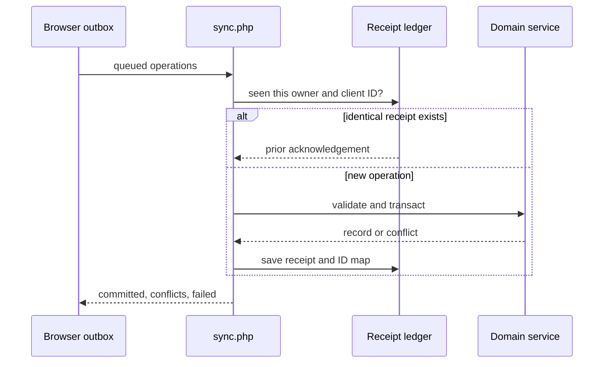

# Offline Synchronization

**Guide:** [Start Here](../Start%20Here.md) · [System Overview](../System%20Overview.md) · [Glossary](../Glossary.md) · [Known Limits](../Current%20Implementation%20Gaps.md)

## Part A — Understanding the Feature

This first part uses everyday language. You can continue to the next lesson without studying the technical section.

### What is this feature?

Supported writes can be placed in a browser outbox while the PHP server is unreachable. Reconnection replays each operation to the authoritative backend.

### Why does the system need it?

A temporary outage should not discard the owner’s work, but local data must not silently overwrite newer server data or bypass business rules.

### Follow Ana’s fictional rental

An owner saves Ana’s booking while offline. The browser assigns a local ID and operation ID. After reconnection, the server validates the booking, maps the local ID to its database ID, and stores a receipt. If the reply is lost, retry returns the same acknowledgement instead of creating a duplicate.

### Step-by-step workflow

1. `js/api.js` detects a network failure for a supported write.
2. `js/offline.js`/`js/storage.js` retain an operation with `client_id`, entity, action, data, owner, and optional local ID. Money writes are first validated and calculated as integer cents, so excess precision never enters the queue.
3. `js/sync.js` sends up to 100 operations to `POST api/sync.php?do=commit`.
4. The server resolves local references and checks a per-owner receipt. After acceptance, the browser replaces temporary booking/payment primary keys and their cached links with the acknowledged server IDs.
5. Each operation gets its own transaction and shared domain validation, including the same cent precision and remaining-balance rules used by direct payment and deposit endpoints.
6. The reply separates committed, conflict, and failed operations. Pending payment drafts remain separate from server-confirmed `amount_paid`; accepted totals change only after acknowledgement and refresh.
7. Conflicts and failures stay visible for owner review. A rejected payment or deposit can be corrected in place and retried with the same operation ID, so the receipt check still protects against a duplicate while unrelated queued work remains untouched.

### What Happens Behind the Scenes?

The receipt ledger and local-to-server ID map live in `APP_SETTINGS` row 2. Identical retries return the stored acknowledgement; reusing an accepted operation ID with changed data fails. Booking `_base` values detect stale edits for reservation fields and mutable pricing fields: service, package, add-ons, discount, fees, agreed total, preparation, and travel allowances.

Temporary aliases exist only to resolve dependent queued operations. They must not translate an acknowledged server booking or payment back into a `LOCAL-*` primary key. Remapping is idempotent: replaying after the queue is empty creates no second booking or payment.

Rejected monetary drafts retain their queue entry and editable amount. Before retry, the browser applies the same positive-value and two-decimal validation used for a new draft, updates the matching cached Pending Sync record, and replays the original `client_id`. An accepted operation cannot be changed under that identity, while an operation the server rejected has no receipt and may safely be corrected.

### Visual explanation

The diagram shows a queued action reaching the server, being checked for an earlier receipt, and then being accepted or returned for review.

### Important things to remember

- A successful HTTP response may still contain conflicts or failures.
- The batch is not atomic; one failed operation does not roll back accepted neighbors.
- A payment linked to a locally created booking adopts its own server payment ID and the booking's server ID after acknowledgement; neither record is duplicated on an empty retry.
- Correcting a rejected payment or deposit does not discard other queued operations and does not generate a replacement operation identity.
- Stale detection covers selected booking reservation and pricing fields, not every entity or field. Conflicts retain the draft and display previous, current server, and proposed values for owner resolution.
- One growing JSON receipt row serializes commits and has no retention policy.
- Offline UI evidence is synthetic/local; real device, quota, network, and multi-user acceptance remain deployment checks.
- Offline sync is approved and retained even though an older revised design document described online-only scope.

### Remember This

The offline queue is a waiting list, not the shared database. A queued change becomes official only after the server validates and accepts it.

## Part B — Technical Explanation

This section names the files, routes, tables, and validation rules. Beginner readers may skip it and continue to the next lesson.

### Technical details

`api/sync.php`, `api/sync_state.php`, shared `*_service.php` files; `js/sync.js`, `js/offline.js`, `js/storage.js`, `js/sync-ui.js`. Storage: browser local data plus `APP_SETTINGS.settings_id=2`.

### Technical references

[sync.php](../Backend/Files/sync.php.md) · [sync_state.php](../Backend/Files/sync_state.php.md) · [APP_SETTINGS](../Database/Tables/APP_SETTINGS.md)

## Continue Your Learning

**You’ve learned:** the difference between saving a change temporarily on one device and having the shared server accept it.

**Previous lesson:** [Post-event Completion](Post-event%20Completion.md)

**Next lesson:** [Reports and Audit History](Reports.md)

**Why read this next?** Once records are accepted by the shared system, the next lesson explains how owners turn them into useful summaries and history.

**Return to your learning dashboard:** [Start Here](../Start%20Here.md)
