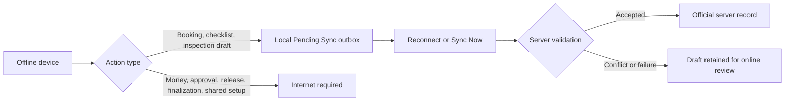

# Offline Synchronization

**Guide:** [Start Here](../Start%20Here.md) · [System Overview](../System%20Overview.md) · [Glossary](../Glossary.md) · [Known Limits](../Current%20Implementation%20Gaps.md)

## Part A — Understanding the Feature

### What is this feature?

The system is online-first. During a temporary outage, it can preserve only three kinds of recovery work on the current device:

- a new booking draft;
- generated or edited checklist drafts; and
- a return-inspection draft.

Payments, deposits, deductions, refunds, booking changes or approvals, cancellations, releases, final completion, delivery, catalog, inventory, gallery metadata, settings, website content, and owner changes require an internet connection. Reports may show the last saved values, but they do not create offline records.

### Why is it limited?

Drafting work can safely wait for server review. Money, approvals, final lifecycle decisions, and shared configuration must be checked against the current database immediately so another device cannot unknowingly create a contradictory official record.

### Follow Ana’s fictional rental

Ana starts a new booking while the connection is down. The browser labels it **Pending Sync** and gives it a temporary ID. When internet returns, synchronization starts automatically; Ana may also choose **Refresh data and sync**.

When Ana is online, creating a booking goes directly to the booking API and the browser shows the official server result. A local draft is created only when the browser is already offline or the create request fails at the network layer. A server validation or conflict response remains an online error and is never converted into a local draft.

The server then applies the normal booking and availability rules. If no conflict exists, the server accepts the booking and replaces its temporary ID. If another owner already accepted an overlapping booking, Ana’s draft stays on the device as a visible conflict. It does not become official until an owner resolves the conflict online.

Ana may also draft the booking checklist and returned-item inspection offline. She cannot confirm the release, record money, approve an overlap, cancel the booking, or complete the post-event review until she is online.

If Ana entered an intended down payment while the network failed, the amount and method remain only as a local reminder. They do not change `amount_paid`, payment history, dashboard revenue, or reports. After the booking receives its server ID, the reminder follows that ID and tells Ana to record the real payment online.

### Step-by-step workflow

1. A supported offline action is saved in the browser outbox with an operation ID and owner ID.
2. The sync panel shows the draft as pending. Closing and reopening the page does not make it official.
3. Reconnection automatically sends the outbox to `POST api/sync.php?do=commit`; **Refresh data and sync** performs the same replay manually.
4. The server accepts only the limited recovery actions and runs normal booking, checklist, inspection, and conflict validation.
5. The response separates committed, conflicting, and failed operations. Accepted operations receive server IDs; rejected or conflicting drafts remain visible.
6. Replaying the same accepted operation returns its saved acknowledgement instead of creating a duplicate.

### Visual explanation

### Important things to remember

- **Pending Sync** means saved on this device, not accepted by the business database.
- An intended payment reminder is not a receipt or accepted payment and must be recorded online.
- Automatic and manual synchronization use the same server validation.
- A successful HTTP response may still contain an operation conflict or failure.
- The sync endpoint also enforces the allowlist, so an old or modified browser cannot replay an online-only action.
- Cached pages and values can be stale; the browser does not download new server data while offline.
- Offline setup still requires an earlier authenticated online session, cached pages/data, HTTPS or localhost, and available browser storage.
- Local synthetic tests do not replace physical-device, Hostinger, multi-owner, storage-quota, or client acceptance.

### Remember This

Offline mode is a recovery notebook, not a second database. It protects draft work while keeping money and final decisions online and authoritative.

## Part B — Technical Explanation

`js/sync.js` sends `createBooking`, `generateBookingChecklist`, `updateBookingItem`, and `recordReturn` directly to the server while online and falls back to a local outbox draft only for an offline state, a temporary local booking, or a transport-level network failure. This ordering ensures checklist updates reach the server before release and return inspections reach it before final review. Other writes call their direct `js/api.js` methods and raise `online_required` when the browser is offline. `js/sync-ui.js` explains the boundary and disables internet-required booking, money, catalog, settings, content, gallery, inventory, and owner controls while offline.

`api/sync.php` accepts only `bookings/create`, `bookingItems/generate`, `bookingItems/update`, and `equipment/inspect`. An offline booking create must be Pending, unpaid, and contain no conflict-approval fields. Receipts and local-to-server ID aliases remain in the private sync state so retries stay idempotent. Each accepted operation retains its own transaction; the returned batch can contain committed, conflicting, and failed results together.

### Technical references

[sync.php](../Backend/Files/sync.php.md) · [sync_state.php](../Backend/Files/sync_state.php.md) · [APP_SETTINGS](../Database/Tables/APP_SETTINGS.md)

## Continue Your Learning

**You’ve learned:** which recovery drafts can wait on one device and which decisions require the shared server immediately.

**Previous lesson:** [Post-event Completion](Post-event%20Completion.md)

**Next lesson:** [Reports and Audit History](Reports.md)

**Why read this next?** Once records are accepted by the shared system, the next lesson explains how owners turn them into useful summaries and history.

**Return to your learning dashboard:** [Start Here](../Start%20Here.md)
