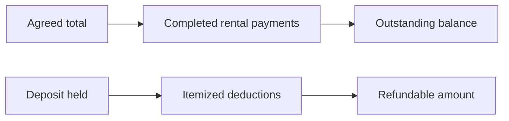

# Payments and Deposits

**Guide:** [Start Here](../Start%20Here.md) · [System Overview](../System%20Overview.md) · [Glossary](../Glossary.md) · [Known Limits](../Current%20Implementation%20Gaps.md)

## What is this feature?

Rental payments reduce the booking balance. A refundable deposit is separate money held against damage, loss, or cleaning and may have itemized deductions before refund.

## Why does the system need it?

Mixing these amounts would make revenue and customer balances misleading.

## Realistic example

Ana owes ₱2,750. Two Completed rental-payment rows totaling ₱2,000 leave ₱750 outstanding. A separate ₱500 deposit with a ₱100 damaged-cable deduction has a ₱400 refundable balance.

## Step-by-step workflow

1. Record a rental payment with type, method, status, date, optional reference, and owner.
2. The booking view sums only Completed payments.
3. Corrections update the payment with an audit reason; they do not create a money transfer.
4. Create or update one deposit for the booking.
5. Add itemized deductions, each with affected item, reason, and amount.
6. Mark a positive remaining refund as Refunded when the real-world refund has been handled.

## What happens behind the scenes?

Money is converted to integer cents for validation and returned as two-decimal strings. Payment state is derived: Unpaid, Partially Paid, or Fully Paid. Deposit refundable amount is amount held minus the sum of deductions. A transaction locks the relevant booking/deposit before changes.

## Visual explanation

## Important rules and limitations

- Only Completed payment rows count toward collected revenue or the booking balance.
- Methods are GCash or MariBank. Statuses are Pending, Completed, or Failed.
- A deduction cannot exceed the remaining held amount.
- Deposits and deductions do not count as rental revenue.
- The application records money events; it does not contact GCash, MariBank, a bank, or a refund gateway.
- Overpayment and cancellation-refund policy are not invented by the code.

## Technical details

`payments.php` and `payment_service.php`; `deposits.php` and `deposit_service.php`. Tables: `PAYMENTS`, `DEPOSITS`, `DEPOSIT_DEDUCTIONS`, `AUDIT_LOGS`.

## Related documentation

[Post-event Completion](Post-event%20Completion.md) · [PAYMENTS](../Database/Tables/PAYMENTS.md) · [DEPOSITS](../Database/Tables/DEPOSITS.md)
