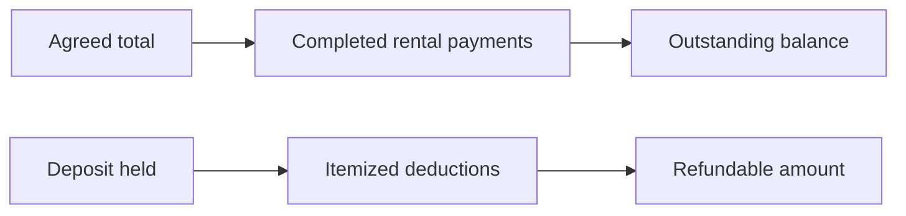

# Payments and Deposits

**Guide:** [Start Here](../Start%20Here.md) · [System Overview](../System%20Overview.md) · [Glossary](../Glossary.md) · [Known Limits](../Current%20Implementation%20Gaps.md)

## Part A — Understanding the Feature

This first part uses everyday language. You can continue to the next lesson without studying the technical section.

### What is this feature?

Rental payments reduce the booking balance. A refundable deposit is separate money held against damage, loss, or cleaning and may have itemized deductions before refund.

### Why does the system need it?

Mixing these amounts would make revenue and customer balances misleading.

### Follow Ana’s fictional rental

Ana owes ₱2,750. Her first Completed rental payment is ₱2,000, leaving ₱750 outstanding. A separate ₱500 deposit with a ₱100 damaged-cable deduction has a ₱400 refundable balance.

### Step-by-step workflow

1. Record a rental payment with type, method, status, date, optional reference, and owner.
2. The booking view sums only Completed payments.
3. Correct a payment from its history with an audit reason; direct and offline saves use the same server rule and do not create a money transfer.
4. Record one held deposit amount. After that write is accepted or queued, the booking screen locks the amount instead of presenting it as editable.
5. Add itemized deductions, each with affected item, reason, and amount.
6. Mark a positive remaining refund as Refunded when the real-world refund has been handled.

### What Happens Behind the Scenes?

Money is converted to integer cents for validation and returned as two-decimal strings. Payment state is derived: Unpaid, Partially Paid, or Fully Paid. Deposit refundable amount is amount held minus the sum of deductions. A transaction locks the relevant booking/deposit before changes.

### Visual explanation

The two lines stay separate on purpose: rental payments reduce the rental balance, while deductions reduce only the refundable deposit.

### Important things to remember

- Only Completed payment rows count toward collected revenue or the booking balance.
- Methods are GCash or MariBank. Statuses are Pending, Completed, or Failed.
- A deduction cannot exceed the remaining held amount.
- Deposits and deductions do not count as rental revenue.
- The application records money events; it does not contact GCash, MariBank, a bank, or a refund gateway.
- A Completed payment cannot exceed the remaining booking balance. Record the exact remaining amount instead; a separate credit/refund workflow would require a new approved policy.
- If a correction makes a reviewed Completed booking unpaid, the payment and lifecycle change commit together: the booking returns to Awaiting Payment, keeps its completed equipment review, clears its completion time, and opens an owner notification for the exact balance.

### Remember This

Ana pays ₱2,000 toward her ₱2,750 rental, leaving ₱750. Her separate ₱500 deposit has a ₱100 deduction, leaving ₱400 refundable.

## Part B — Technical Explanation

This section names the files, routes, tables, and validation rules. Beginner readers may skip it and continue to the next lesson.

### Technical details

`payments.php` and `payment_service.php`; `deposits.php` and `deposit_service.php`. Tables: `PAYMENTS`, `DEPOSITS`, `DEPOSIT_DEDUCTIONS`, `AUDIT_LOGS`.

### Technical references

[Post-event Completion](Post-event%20Completion.md) · [PAYMENTS](../Database/Tables/PAYMENTS.md) · [DEPOSITS](../Database/Tables/DEPOSITS.md)

## Continue Your Learning

**You’ve learned:** how rental payments, remaining balances, refundable deposits, deductions, and refunds stay separate.

**Previous lesson:** [Availability and Conflicts](Availability%20and%20Conflicts.md)

**Next lesson:** [Equipment Release and Return](Equipment%20Release%20and%20Return.md)

**Why read this next?** Once the financial records are clear, follow how the business prepares and tracks the equipment included in Ana’s package.

**Return to your learning dashboard:** [Start Here](../Start%20Here.md)
