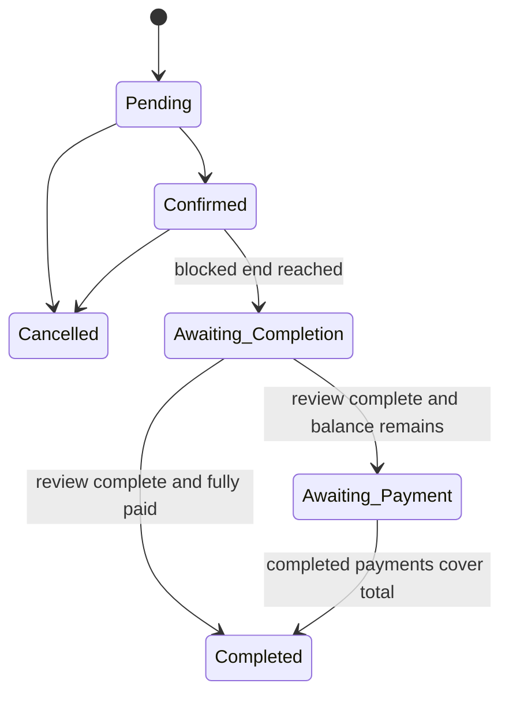

# Post-event Completion

**Guide:** [Start Here](../Start%20Here.md) · [System Overview](../System%20Overview.md) · [Glossary](../Glossary.md) · [Known Limits](../Current%20Implementation%20Gaps.md)

## What is this feature?

Post-event completion records that equipment, deposit, payment, and service-readiness checks were performed before a service becomes available again.

## Why does the system need it?

An event ending does not prove that equipment returned or that the service can support another booking. The system therefore requires an owner decision.

## Realistic example

After Ana’s blocked end, her Confirmed booking becomes Awaiting Completion. The owner inspects every checklist row, reviews payments and deposits, enters notes, and confirms the service is ready. If ₱750 remains unpaid, the booking becomes Awaiting Payment while the karaoke service is released. After a Completed payment covers ₱750, the owner completes the booking.

## Step-by-step workflow

1. The scheduler or request fallback changes ended Confirmed bookings to Awaiting Completion.
2. A persistent owner notification appears.
3. The owner supplies complete checklist results, any deductions, review confirmations, and notes.
4. One transaction validates and saves the review and sets `released_by`.
5. With no rental balance, status becomes Completed. With a balance, status becomes Awaiting Payment and an exact-balance notice remains.
6. After completed payments cover the total, a completion action changes Awaiting Payment to Completed and resolves the notice.

## What happens behind the scenes?

Reconciliation and release share service locks, so availability cannot briefly show an overdue, unreleased service as free. Audit rows record system reconciliation, manual release, and payment completion. Notifications are workflow-resolved rather than arbitrarily deleted.

## Visual explanation

## Important rules and limitations

- An owner cannot use an ordinary edit to bypass this workflow.
- Review requires service-ready, payments-reviewed, deposits-reviewed, nonempty notes, and complete checklist evidence.
- Awaiting Completion continues blocking the service without an effective end.
- Awaiting Payment has released capacity but is not a completed rental.
- Scheduler registration is a deployment task; calendar/booking/notification requests also call reconciliation as a fallback.

## Technical details

`availability_service.php::reconcileBookings()` and `releaseBooking()`; `equipment_service.php`; `scripts/reconcile_bookings.php`. Tables: `BOOKINGS`, `BOOKING_CHECKLIST_ITEMS`, `NOTIFICATIONS`, `AUDIT_LOGS`, `PAYMENTS`, `DEPOSITS`, `DEPOSIT_DEDUCTIONS`.

## Related documentation

[Availability and Conflicts](Availability%20and%20Conflicts.md) · [NOTIFICATIONS](../Database/Tables/NOTIFICATIONS.md) · [AUDIT_LOGS](../Database/Tables/AUDIT_LOGS.md)
