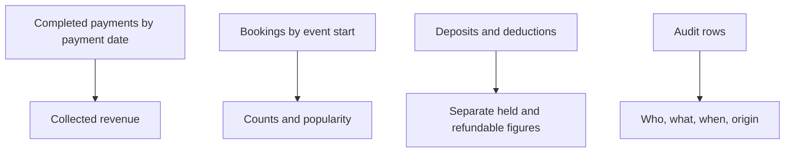

# Reports and Audit History

**Guide:** [Start Here](../Start%20Here.md) · [System Overview](../System%20Overview.md) · [Glossary](../Glossary.md) · [Known Limits](../Current%20Implementation%20Gaps.md)

## Part A — Understanding the Feature

This first part uses everyday language. You can continue to the next lesson without studying the technical section.

### What is this feature?

Reports summarize operational records. Audit history explains who or what changed sensitive records and when.

### Why does the system need it?

Owners need inspectable business summaries without treating deposits, pending payments, or booking value as collected rental income.

### Follow Ana’s fictional rental

Ana’s Completed GCash payment is counted as collected revenue on its `payment_date`. Her deposit is shown separately. If her event was cancelled, it appears in cancellation counts and retained detail rows but is not silently erased.

### Step-by-step workflow

1. Choose a date range for the detailed report.
2. Revenue sums Completed payments whose payment date is in the range.
3. Event counts and popularity use booking event-start dates in the range.
4. Outstanding balances use agreed totals minus all Completed payments and exclude Cancelled bookings.
5. Deposits, refundable balances, and deductions are lifetime operational figures.
6. Upcoming, cancellation, and overlap endpoints return inspectable rows.
7. Audit logs are read-only and paginated by audit ID.

### What Happens Behind the Scenes?

`reports.php` returns metric definitions with its data. Dashboard defaults to the current month in Asia/Manila. Compatibility fields remain for current screens. `audit.php` reads append-only `AUDIT_LOGS`; migration archive rows may also be included as historical evidence.

### Visual explanation

The diagram groups the source records by purpose: payments feed revenue, bookings feed activity counts, deposits remain separate, and audit rows explain changes.

### Important things to remember

- Reports are operational summaries, not formal accounting statements or proof of bank settlement.
- Pending and Failed payments do not count as revenue. Deposits never count as rental revenue.
- Payments, Dashboard, and Reports use the same lifetime outstanding-balance rule and exclude Cancelled or Rejected bookings.
- Completed and cancellation totals are lifetime in `reportsBookings()`, while upcoming is period-filtered; definitions in the response disclose this.
- `damaged_or_missing` is a global checklist count in the compatibility report field.
- Dashboard inventory counts are placeholders set to zero.
- Production reconciliation and representative-data performance remain external acceptance work.

### Remember This

Collected revenue uses Completed payments and their payment dates. Deposits are separate, and audit history records who or what changed important records.

## Part B — Technical Explanation

This section names the files, routes, tables, and validation rules. Beginner readers may skip it and continue to the next lesson.

### Technical details

`GET api/reports.php?do=dashboard`, `?do=report&start=YYYY-MM-DD&end=YYYY-MM-DD`, `?do=upcoming|cancellations|overlaps`. `GET api/audit.php?after_id=…&limit=…`. Tables: `PAYMENTS`, `BOOKINGS`, `DEPOSITS`, `DEPOSIT_DEDUCTIONS`, `BOOKING_CONFLICT_OVERRIDES`, `AUDIT_LOGS`.

### Technical references

[reports.php](../Backend/Files/reports.php.md) · [audit.php](../Backend/Files/audit.php.md) · [AUDIT_LOGS](../Database/Tables/AUDIT_LOGS.md)

## Continue Your Learning

**You’ve learned:** where report figures come from and why operational summaries are different from formal accounting.

**Previous lesson:** [Offline Synchronization](Offline%20Synchronization.md)

**Next lesson:** [Deployment and Limitations](../Deployment%20and%20Limitations.md)

**Why read this next?** You now understand the complete business journey. Finish the non-developer path by learning what still needs verification before real deployment.

**Return to your learning dashboard:** [Start Here](../Start%20Here.md)
